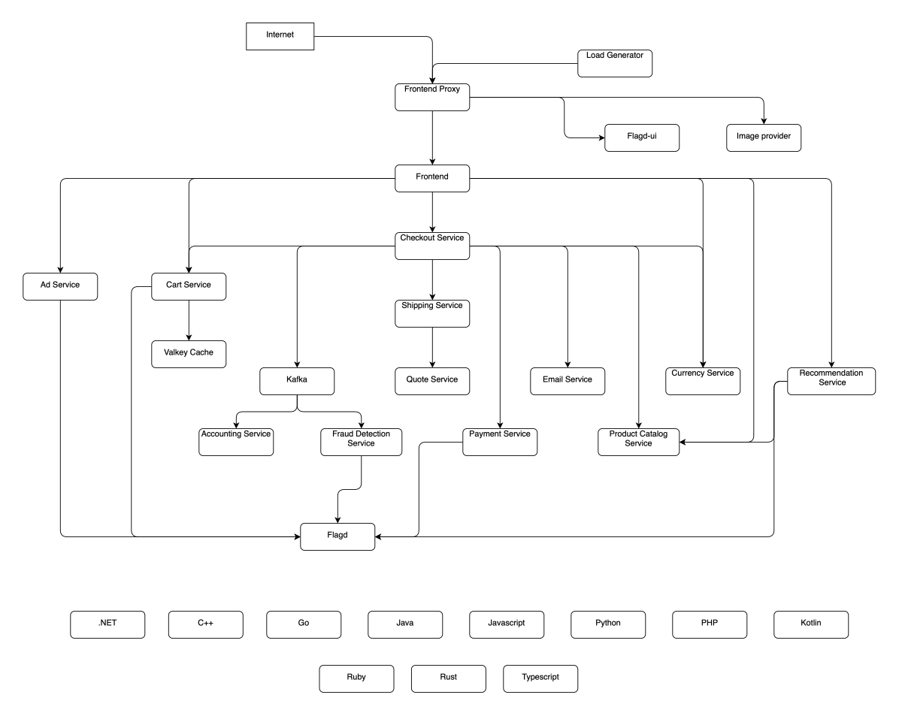
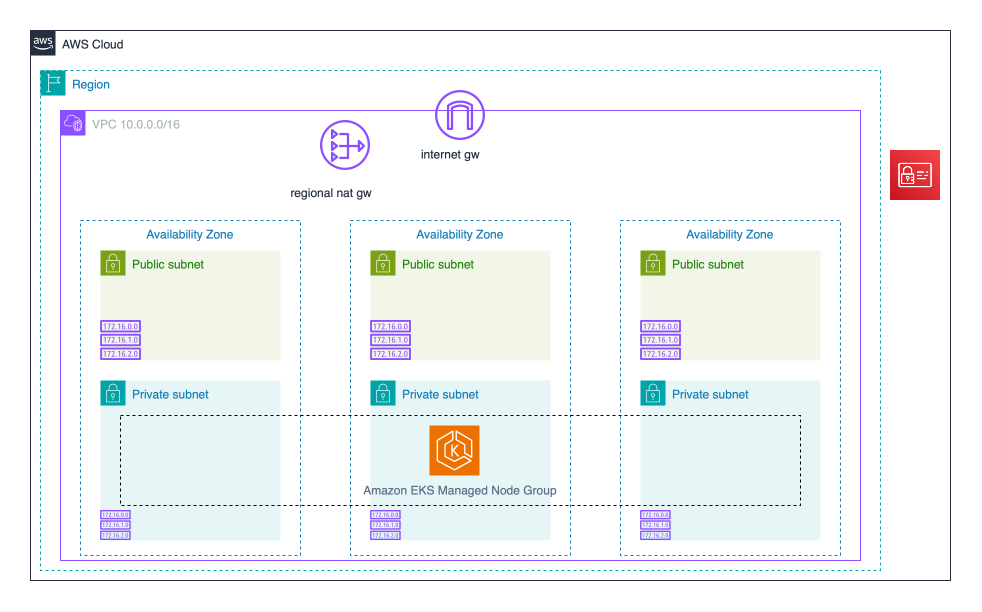
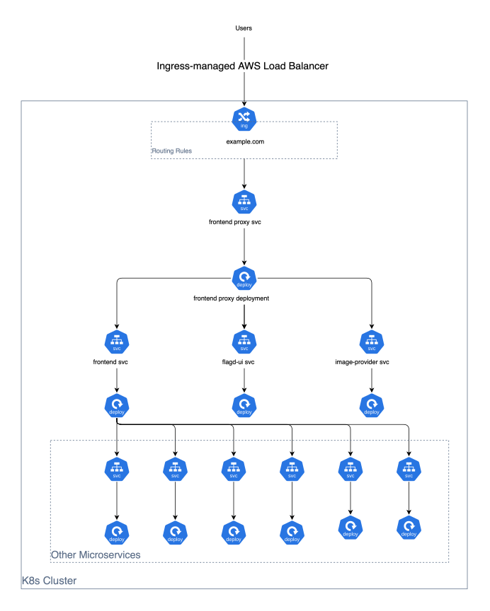
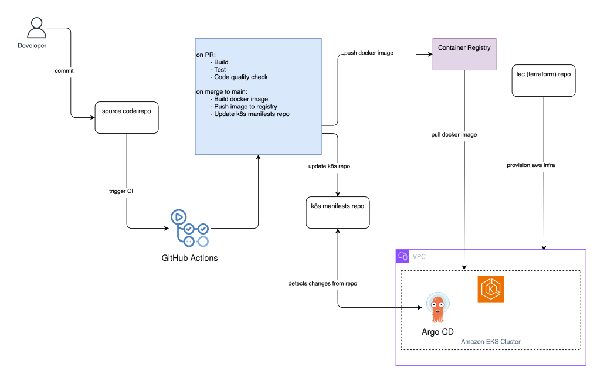
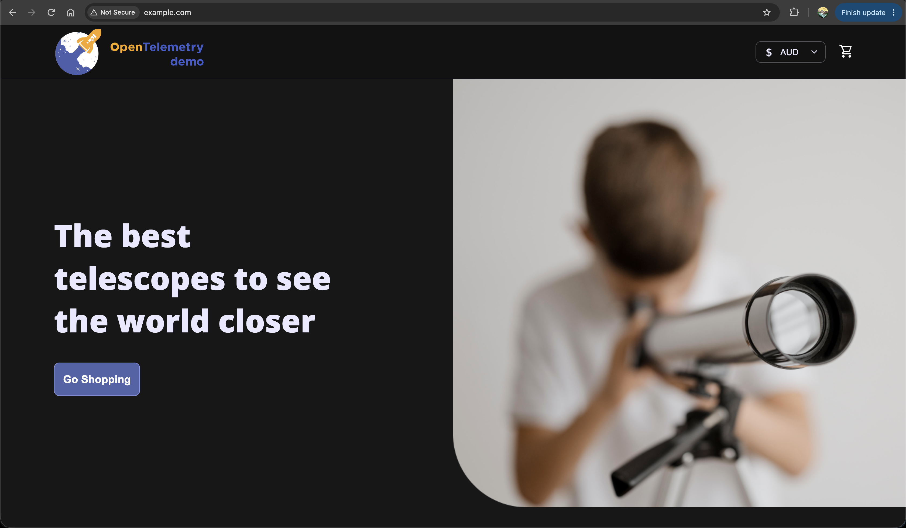
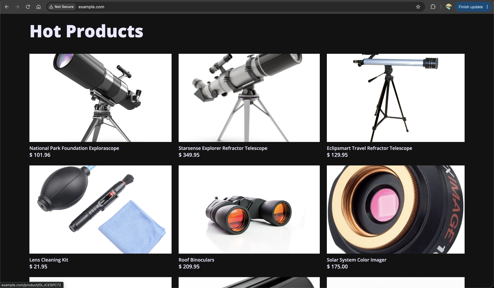
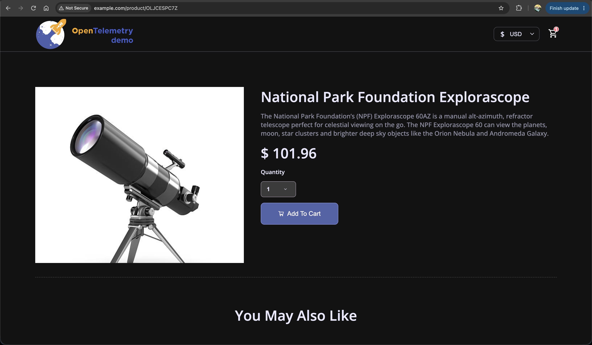
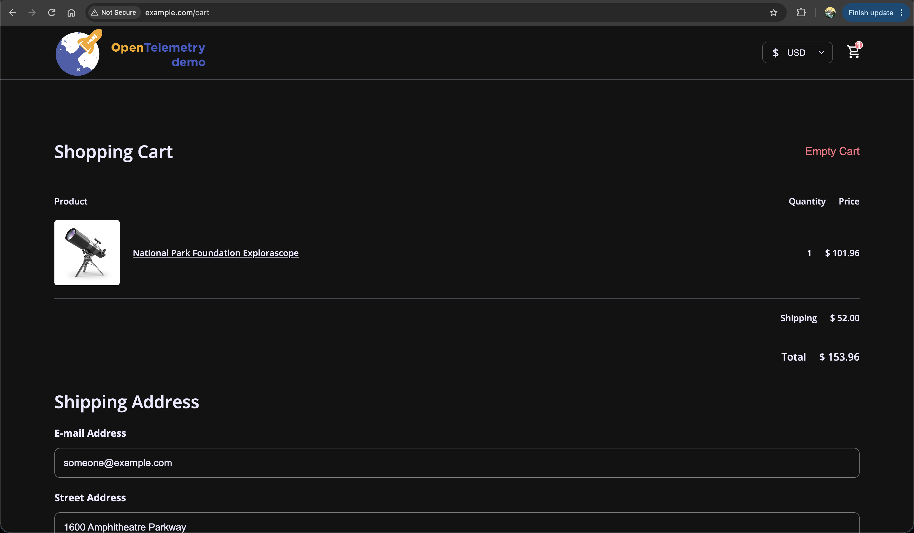
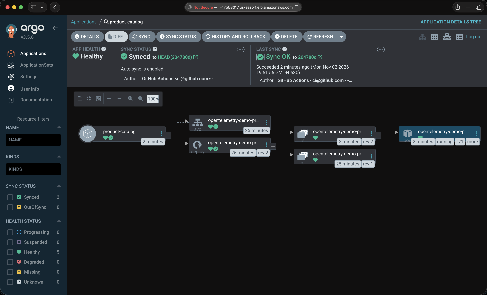

# E-Commerce DevOps Project

A complete DevOps project demonstrating infrastructure provisioning, container orchestration, and a GitOps-based CI/CD pipeline on AWS — built around the OpenTelemetry Astronomy Shop, a microservice-based distributed e-commerce application.

The application source code is is originally from [opentelemetry-demo](https://github.com/open-telemetry/opentelemetry-demo). Thanks to the team and contributors for opensourcing this wonderful project.

---

### Application Architecture

---

### AWS Infrastructure

---

### EKS Data Plane Architecture

---

### Repositories

| Repository                                                                                 | Description                                                                                                                                                                                                    |
| ------------------------------------------------------------------------------------------ | -------------------------------------------------------------------------------------------------------------------------------------------------------------------------------------------------------------- |
| [e-commerce-devops-project-iac](https://github.com/tharix46/e-commerce-devops-project-iac) | Terraform code to provision AWS infrastructure: VPC, subnets, Internet gateway, NAT gateway, and EKS cluster with managed node groups                                                                          |
| [e-commerce-devops-project-k8s](https://github.com/tharix46/e-commerce-devops-project-k8s) | Kubernetes manifests for all microservices deployed to EKS; watched by ArgoCD for GitOps-based continuous deployment                                                                                           |
| [e-commerce-devops-project-src](https://github.com/tharix46/e-commerce-devops-project-src) | Application source code with a GitHub Actions CI pipeline: runs build, test, code quality check on PR, builds and pushes a Docker image to DockerHub, and updates the image tag in the k8s repository on merge |

---

---

### How It Works

> **Note**: This project has 20 microservices. CI/CD is configured to build and deploy only the `product catalog` microservice for demonstration purposes.

---

### Tech Stack

| Category                | Tools          |
| ----------------------- | -------------- |
| Cloud                   | AWS            |
| Infrastructure as Code  | Terraform      |
| Container Orchestration | Kubernetes     |
| CI                      | GitHub Actions |
| GitOps                  | ArgoCD         |
| Containerization        | Docker         |

---

### Few Screenshots

#### Application Frontend

#### Product Catalog

#### Cart

#### ArgoCD Dashboard

---
